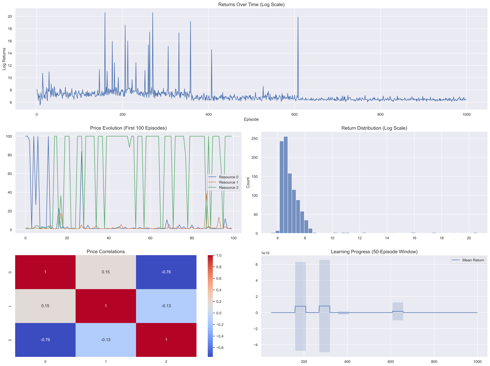

# Anuja’s MARL Trading Lab

A high-signal, research-friendly sandbox for multi-agent reinforcement learning in a *stylized* market simulator.
It’s built to be fast to iterate on, reproducible, and easy to evaluate.

This repo is **not** financial advice and is **not** a real-market backtesting engine.



## Overview

- **Multi-agent, multi-asset** trading environment (`src/environment/trading_env.py`)
- **Execution-aware mechanics**: spread, fees, temporary impact (slippage), permanent impact
- **Exogenous price dynamics**: correlated, autocorrelated log-returns
- **Learning agents**:
  - **PPO for continuous actions**: squashed Gaussian policy + GAE + minibatch updates (`src/agents/ppo_agent.py`)
  - **CEM (numpy-only) fallback**: cross-entropy method over a linear tanh policy (`src/agents/cem_agent.py`)
- **Evaluation harness** with baselines + risk metrics (`evaluate.py`, `src/evaluation/metrics.py`)
- **Dashboards & episode diagnostics** (`src/visualization/visualize.py`)

## Quickstart

```bash
python -m venv venv
source venv/bin/activate
pip install -r requirements.txt
```

### Train
```bash
python train.py --overwrite
```
By default, training uses the `wow` preset (CEM, high signal + high trading friction).
Training also runs a quick evaluation at the end and writes `eval.json` + `RUN.md`.
Disable with `--no-eval` or set `--eval-episodes 0`.

For a reproducible demo-style run:
```bash
make wow
```

Run the full pipeline:
```bash
make all
```

Common knobs:
```bash
python train.py --episodes 500 --steps 200 --agents 2 --save-dir results/run1
python train.py --reward-mode log_return --risk-aversion 0.05 --save-dir results/run2
python train.py --algo cem --cem-population 32 --save-dir results/run3
python train.py --algo baseline --baseline-policy momentum --save-dir results/run4
python train.py --preset wow --overwrite
python train.py --preset default --algo auto --save-dir results/run0 --overwrite
```

### Evaluate
Compare the run’s agent (PPO or CEM) vs baselines:
```bash
python evaluate.py --run-dir results/wow --episodes 100
```
`evaluate.py` auto-loads `config.json` from the run directory (so env params match the run).

### Torch/Sandbox Note
Some restricted sandboxes hard-crash when importing `numpy` and `torch` together (often `OMP: Error #179 ... SHM2`).
In that case `--algo auto` falls back to CEM, and `evaluate.py` will skip PPO checkpoints.

### Tests
```bash
python -m unittest discover -s tests
```
Or: `make test`

## Outputs

Each run directory (e.g. `results/wow/`) contains:
- `RUN.md`: one-page run card (config + key metrics)
- `ppo_agent.pt`: PPO checkpoint (if PPO ran)
- `cem_policy.npz`: CEM policy (if CEM ran)
- `config.json`: exact run config
- `meta.json`: environment + git metadata
- `metrics.jsonl`: per-episode metrics (reward, losses, etc.)
- `eval.json`: agent vs baseline evaluation summary
- `analysis_dashboard.png`: training dashboard
- `episode_diagnostics.png`: a single-episode deep dive
- `price_storyboard.png`: keyframes of a single-episode price path (PNG fallback for GIF viewers)

## Notes
- This is a *controlled simulator* intended for RL iteration (impact-aware execution + stochastic prices), not market realism.
- See `notebooks/analysis.ipynb` for exploratory analysis.
